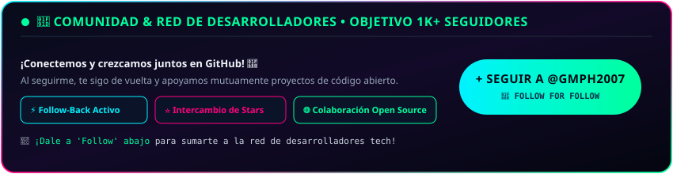
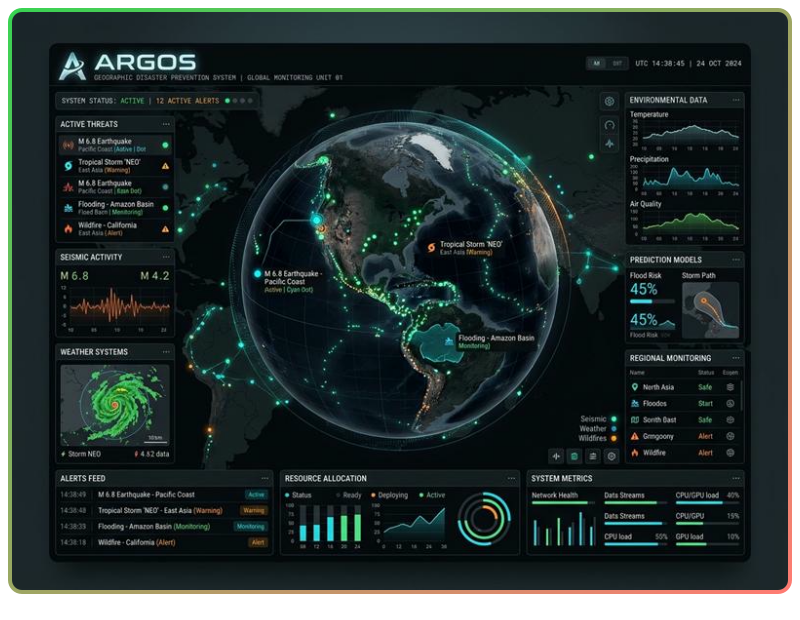
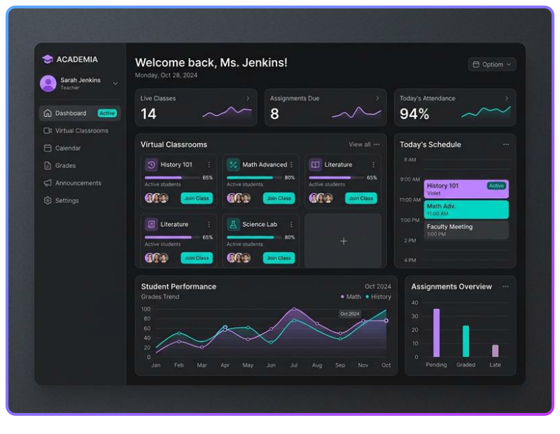
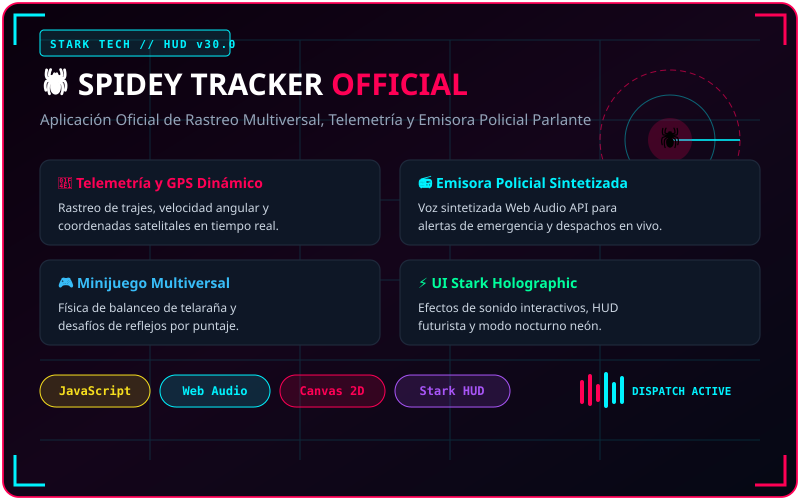
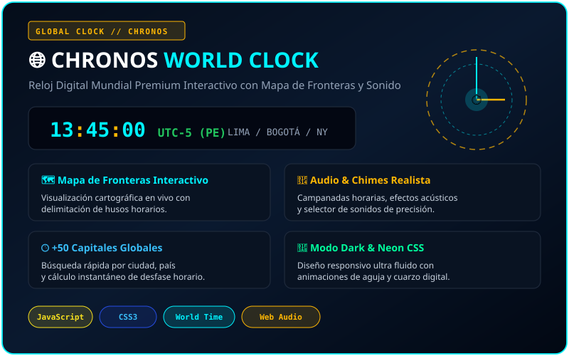

<!-- GMPH2007 | Gerson Misael Pintado Huamán | © 2024-2026 All Rights Reserved -->

<!-- IDIOMAS -->

 

**🌍 Ver en tu idioma:**&nbsp;
&nbsp;
&nbsp;
&nbsp;
&nbsp;
&nbsp;

 

<!-- TEXTO ANIMADO -->

 

<!-- BADGES DE ESTADO -->

&nbsp;
&nbsp;
&nbsp;

 

&nbsp;
&nbsp;
&nbsp;

 

<!-- COMUNIDAD -->

 

<!-- TERMINAL ANIMADO -->

## 🏆 Logros Oficiales de GitHub

&nbsp;
&nbsp;
&nbsp;

 

## 🚀 Proyectos Destacados

 

 

## 🛠️ Stack Tecnológico

**Frontend**

&nbsp;
&nbsp;
&nbsp;
&nbsp;
&nbsp;
&nbsp;

  

**Backend**

&nbsp;
&nbsp;
&nbsp;
&nbsp;
&nbsp;

  

**DevOps & Tools**

&nbsp;
&nbsp;
&nbsp;
&nbsp;

## 🐍 Mapa de Contribuciones Vivo

## 📊 Estadísticas GitHub

 

 

 

 

## 💼 Reconocimientos Profesionales

&nbsp;
&nbsp;

 

&nbsp;
&nbsp;

## 📫 Conectate Conmigo

 

**Tienes un proyecto o idea? Escribeme directamente!**

 

&nbsp;
&nbsp;
&nbsp;

  

© 2024-2026 <strong>Gerson Misael Pintado Huamán</strong> • Piura, Perú • Todos los derechos reservados

